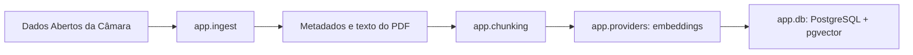
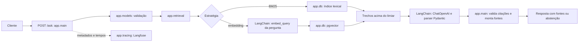

# RAG Legislativo com respostas citadas

API de consulta a proposições legislativas da Câmara dos Deputados. Recupera trechos com BM25 ou embeddings, responde somente a partir do contexto recuperado, retorna fontes oficiais e se abstém quando não há evidência suficiente.

## Arquitetura

```text
Dados Abertos da Câmara ──> ingestão e chunking ──> embeddings ──> PostgreSQL + pgvector
                                                               │
POST /ask ──> BM25 ou busca vetorial ──> limiar de evidência ──> LangChain LCEL + chat compatível com OpenAI
       └───────────────────────────── Langfuse: traces e avaliações
```

A ingestão usa proposições, ementas, palavras-chave e situação de tramitação atual. Quando a listagem não contém o link da íntegra, consulta os detalhes na API v2 da Câmara; baixa PDFs oficiais de até 20 MB e indexa o texto extraível. Documentos sem texto integral podem ser indexados pela ementa. PDFs digitalizados sem camada de texto não passam por OCR. O ID numérico da Câmara é a chave do documento; a referência legível (por exemplo, `PL 4513/2020`), URI oficial, título e data acompanham cada chunk.

## Estrutura do projeto e fluxo

```text
.
├── app/
│   ├── main.py          # API FastAPI: health, consulta e ciclo de vida
│   ├── models.py        # Validação dos pedidos e formato das respostas
│   ├── settings.py      # Configuração carregada das variáveis de ambiente
│   ├── ingest.py        # Coleta dados da Câmara e coordena a indexação
│   ├── chunking.py      # Normaliza texto e divide documentos em trechos
│   ├── providers.py     # Adaptadores LangChain para embeddings e geração
│   ├── retrieval.py     # Busca BM25/vetorial, embed_query e limiares
│   ├── db.py            # Schema, persistência, busca pgvector e índice BM25
│   └── tracing.py       # Traces de consulta e métricas no Langfuse
├── data/
│   └── evaluation/      # Golden set e instruções para avaliação
├── docs/                # Documento PDF com o desafio original
├── scripts/
│   └── evaluate.py      # Métricas de recuperação, citações e abstenção
├── tests/               # Testes da API, ingestão, dados e persistência
├── .env.example         # Modelo de configuração da API e do Langfuse
├── .env.db.example      # Modelo das credenciais isoladas do PostgreSQL
├── docker-compose.yml   # Serviços da API e PostgreSQL com pgvector
├── Dockerfile           # Imagem e dependências da API
├── requirements.txt     # Dependências Python do projeto
├── desafio.txt          # Descrição textual do desafio
└── README.md            # Instruções, contrato da API e arquitetura
```

### Fluxo de ingestão



`app.ingest` pagina as proposições e consulta os detalhes da API v2 quando precisa da URL do PDF. Quando solicitado, extrai o texto do PDF. `app.chunking` prepara trechos estáveis; `app.providers` gera os vetores; `app.db` grava o documento e substitui seus trechos dentro de uma transação.

### Fluxo de consulta



`app.main` só devolve uma resposta com fontes quando cada ID citado pertence aos trechos recuperados; caso contrário, responde com abstenção. `app.tracing` registra estratégia, IDs e tempos, sem guardar o texto da pergunta.

### Uso do LangChain

LangChain padroniza apenas a comunicação com os modelos. `OpenAIEmbeddings.embed_documents()` gera vetores durante a ingestão e `embed_query()` gera o vetor da pergunta. Para responder, `ChatPromptTemplate | ChatOpenAI | PydanticOutputParser` monta a cadeia LCEL e valida a resposta e a lista de IDs citados antes de devolvê-las ao fluxo atual da API.

O armazenamento em PostgreSQL/pgvector, o SQL, a busca BM25 e a filtragem dos resultados continuam no projeto. Isso preserva o esquema e os embeddings já indexados. A configuração atual de provedor, URL base, chave e modelos continua em `.env`. O Langfuse permanece como tracing; callbacks automáticos do LangSmith não são habilitados, para não enviar perguntas e trechos para outro serviço.

### Arquivos de apoio

| Arquivo ou pasta | Responsabilidade |
|---|---|
| `app/settings.py` | Lê chaves, URLs, modelos, limiares e parâmetros de ingestão do ambiente. |
| `app/models.py` | Define campos, limites e formatos JSON aceitos pela API. |
| `app/main.py` | Expõe `GET /health` e `POST /ask`, coordena recuperação, geração e citações. |
| `app/ingest.py` | Busca proposições, detalhes e PDFs oficiais; executa a indexação. |
| `app/chunking.py` | Cria trechos com sobreposição e identificadores determinísticos. |
| `app/providers.py` | Adapta embeddings e chat com `langchain-openai`; valida vetores e resposta Pydantic. |
| `app/retrieval.py` | Seleciona BM25 ou busca vetorial, usa embedding de consulta e filtra pelo limiar. |
| `app/db.py` | Gerencia conexão, tabelas, gravação e consultas PostgreSQL/pgvector. |
| `app/tracing.py` | Registra consultas e avaliações no Langfuse quando configurado. |
| `scripts/evaluate.py` | Calcula métricas usando as perguntas do golden set. |
| `data/evaluation/golden.jsonl` | Perguntas e referências esperadas para avaliação reproduzível. |
| `tests/` | Testes automatizados sem chamadas reais aos serviços externos. |
| `docker-compose.yml` e `Dockerfile` | Configuram os serviços e constroem a imagem da API. |
| `.env.example` e `.env.db.example` | Modelos locais de configuração; as cópias `.env` e `.env.db` não devem ser versionadas. |
| `requirements.txt` | Lista as bibliotecas da API, do LangChain e dos testes. |
| `docs/` e `desafio.txt` | Guardam o desafio de referência em PDF e texto. |

## Executar

Requer Docker Compose e uma chave de provedor com API compatível com OpenAI para embeddings e geração.

### 1. Configure o ambiente

```powershell
Copy-Item .env.example .env
Copy-Item .env.db.example .env.db
# Preencha OPENAI_API_KEY em .env (ou MODEL_API_KEY para outro endpoint compatível)
# Configure as chaves do Langfuse em .env e mantenha a senha igual em .env.db e DATABASE_URL.
```

O tracing é opcional: sem `LANGFUSE_PUBLIC_KEY` e `LANGFUSE_SECRET_KEY`, a API funciona sem enviar traces. Se alterar a senha em `.env.db`, atualize também a senha dentro de `DATABASE_URL` no `.env`.

### 2. Inicie os serviços

```powershell
docker compose up --build -d
docker compose ps
```

A API fica em `http://localhost:8001`; Swagger/OpenAPI em `/docs` e `/openapi.json`. `GET /health` não depende do banco ou do provedor; `database_configured` e `model_configured` indicam somente se há configuração, não conectividade. Um erro 503 no `/ask` indica banco ou embeddings indisponíveis; geração indisponível retorna 502. Sem corpus indexado, a consulta retorna a abstenção definida abaixo.

Os defaults do provedor são `text-embedding-3-small` (1.536 dimensões) e `gpt-6-luna`; use `OPENAI_API_KEY` ou configure `MODEL_API_BASE_URL`, `MODEL_API_KEY` e os nomes dos modelos para outro endpoint compatível.

### 3. Indexe proposições

Indexa entre 1 e 5.000 proposições (padrão: 1.000, desde 2020):

```powershell
docker compose exec api python -m app.ingest --limit 1000 --start 2020-01-01
```

Os filtros opcionais `--end YYYY-MM-DD` e `--themes CODIGO,CODIGO` delimitam o período e os códigos temáticos oficiais. `--ementas-only` evita baixar PDFs. A ingestão é idempotente por proposição e divide o texto em chunks de 1.200 caracteres com sobreposição de 180; parâmetros podem ser configurados no ambiente. O comando só considera a proposição indexada após gerar seus embeddings.

### 4. Faça uma consulta

Abra `http://localhost:8001/docs`, selecione `POST /ask` e envie uma pergunta como:

```json
{
  "question": "Quais proposições tratam de educação digital?",
  "top_k": 5,
  "retrieval": "embedding"
}
```

Use `"retrieval": "bm25"` para busca lexical. Em ambos os casos, a geração da resposta requer uma chave de provedor configurada.

### 5. Execute os testes

```powershell
docker compose run --rm --build --no-deps api python -m pytest -q
```

Para parar os serviços sem apagar os dados do banco:

```powershell
docker compose down
```

`docker compose down -v` também remove o volume e apaga os dados persistidos do banco.

## API

`POST /ask` aceita pergunta de 1 a 2.000 caracteres, `top_k` de 1 a `MAX_TOP_K` (padrão 5) e recuperação `bm25` ou `embedding` (padrão):

```json
{
  "question": "Quais proposições tratam de educação digital?",
  "top_k": 5,
  "retrieval": "embedding"
}
```

Resposta com evidência:

```json
{
  "answer": "A PL 4513/2020 institui a Política Nacional de Educação Digital.\n\nFontes:\n- [PL 4513/2020](https://dadosabertos.camara.leg.br/api/v2/proposicoes/...) ",
  "abstained": false,
  "sources": [
    {"document_id": "<id-numérico-da-Câmara>", "reference": "PL 4513/2020", "title": "PL 4513/2020 — Institui a Política Nacional de Educação Digital", "url": "https://dadosabertos.camara.leg.br/api/v2/proposicoes/...", "date": "2020-09-09", "chunk_id": "<id-do-trecho>"}
  ],
  "timings_ms": {"retrieval": 42.1, "generation": 830.4}
}
```

Sem evidência acima do limiar, ou se o modelo não citar trechos recuperados válidos, `answer` é `Não encontrei evidência suficiente nos documentos consultados.`, `abstained` é `true` e `sources` fica vazio. As referências são acrescentadas pela API a partir dos IDs de chunks retornados pelo modelo; uma citação desconhecida causa abstenção. Perguntas vazias e parâmetros inválidos recebem 422; banco e embeddings indisponíveis recebem 503; falhas do provedor de geração recebem 502.

## Avaliação

O conjunto versionado [golden.jsonl](data/evaluation/golden.jsonl) tem 50 perguntas respondíveis, ambíguas e sem resposta, com referências canônicas esperadas. Compare as estratégias sobre o mesmo corpus:

```powershell
docker compose exec api python scripts/evaluate.py
```

O comando imprime Recall@K, NDCG@K e latência p50/p95 de recuperação e registra as métricas no Langfuse quando configurado. Para também medir validade de citações, cobertura de referências ambíguas, abstenção, cobertura lexical da resposta nos trechos citados e latência da geração, use `--answers`; isso faz chamadas ao provedor e pode ter custo:

```powershell
docker compose exec api python scripts/evaluate.py --answers
```

`citation_valid_rate` verifica se os IDs citados pertencem ao contexto recuperado. `groundedness_proxy` estima a proporção de termos da resposta que também aparecem nos trechos citados; é um sinal lexical simples, não mede entailment nem substitui avaliação humana. O Langfuse registra estratégia, modelo, IDs e referências dos trechos, scores, citações, tempos, tokens de entrada/saída da geração e tokens de entrada dos embeddings, sem registrar pergunta, resposta ou texto dos documentos. O Langfuse pode inferir custos a partir do modelo e dos tokens quando houver uma definição de preço para o modelo; endpoints compatíveis precisam de preço cadastrado. O comando de ingestão envia os traces pendentes antes de encerrar. Configure `LANGFUSE_PUBLIC_KEY`, `LANGFUSE_SECRET_KEY` e `LANGFUSE_BASE_URL` no `.env`; sem as duas chaves, o tracing fica desativado.

| Estratégia | Recall@K | NDCG@K | Fonte válida | Groundedness | Latência p50/p95 |
|---|---:|---:|---:|---|---|
| BM25 | medir com `evaluate.py` | medir | medir com `--answers` | revisão humana recomendada | registrado no Langfuse |
| Embeddings + pgvector | medir com `evaluate.py` | medir | medir com `--answers` | revisão humana recomendada | registrado no Langfuse |
| Embeddings + reranker | opcional, fora do MVP | — | — | — | — |

Não há resultados pré-computados no repositório: rode a ingestão e a avaliação no corpus escolhido para produzir uma comparação reproduzível. Atualize as referências do golden set quando alterar o período do corpus.

## Limitações

- A API de dados da Câmara tem limite de 100 itens por página; a ingestão pagina os resultados e consulta detalhes pela API v2 quando a listagem não traz a URL do texto integral.
- O download de PDFs pode tornar a ingestão demorada; o fallback é a ementa e os metadados da proposição. Não há OCR.
- Busca BM25 tokeniza por palavras e não faz stemming português. As duas estratégias são medidas separadamente; seus scores não são combinados.
- Limiares de evidência são defaults iniciais e devem ser calibrados no corpus e no golden set. Cite-validity não substitui avaliação humana de fidelidade.
- A integração padrão usa a API OpenAI, mas `MODEL_API_BASE_URL`, modelos e dimensão podem apontar para um endpoint compatível. Respostas dependem de chave e podem gerar custo.
- As propostas do golden set são um baseline pequeno, centrado em quatro proposições digitais; não representam a cobertura geral do Legislativo.

## Dados oficiais

- [Dados Abertos da Câmara — API e documentação](https://dadosabertos.camara.leg.br/swagger/api.html)
- [Câmara — Dados Abertos e detalhes das proposições](https://dadosabertos.camara.leg.br/swagger/api.html)
- [PL 4513/2020 — Política Nacional de Educação Digital](https://www.camara.leg.br/proposicoesWeb/prop_mostrarintegra?codteor=1929029&filename=Tramitacao-1-PL-4513-2020)
- [PL 2338/2023 — inteligência artificial](https://www.camara.leg.br/proposicoesWeb/fichadetramitacao?idProposicao=2487262)
- [PL 2628/2022 — proteção em ambientes digitais](https://www.camara.leg.br/proposicoesWeb/fichadetramitacao?idProposicao=2477340)
- [PL 2630/2020 — liberdade e transparência na internet](https://www.camara.leg.br/proposicoesWeb/fichadetramitacao?idProposicao=2256735)
